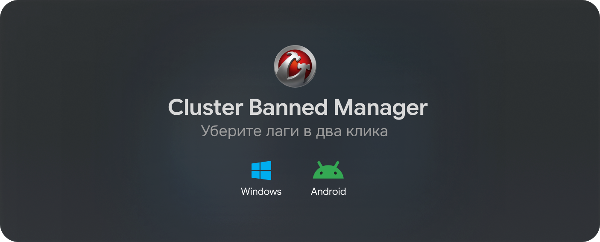

<!-- #  Cluster Banned Manager -->

<div align="center">

[](https://cbmwot.vercel.app/)

[](https://bun.sh/)
[](https://v2.tauri.app/)
[](https://www.rust-lang.org/)
[](https://react.dev/)
[](https://www.typescriptlang.org/)
[](https://www.microsoft.com/windows/)
[](https://www.android.com/)
<picture><source media="(prefers-color-scheme: dark)" srcset="https://shieldcn.dev/github/downloads/SWIRCH/cluster-banned-manager.svg?size=sm&mode=dark&font=geist&variant=outline"></picture>
<picture><source media="(prefers-color-scheme: dark)" srcset="https://www.shieldcn.dev/github/release/SWIRCH/cluster-banned-manager.svg?size=sm&amp;mode=dark&amp;font=geist&variant=outline"></picture>
<picture><source media="(prefers-color-scheme: dark)" srcset="https://www.shieldcn.dev/github/license/SWIRCH/cluster-banned-manager.svg?variant=outline&amp;size=sm&amp;mode=dark&amp;font=geist&variant=outline"></picture>
<picture><source media="(prefers-color-scheme: dark)" srcset="https://www.shieldcn.dev/github/stars/SWIRCH/cluster-banned-manager.svg?variant=outline&amp;size=sm&amp;mode=dark&amp;font=geist"></picture> <picture><source media="(prefers-color-scheme: dark)" srcset="https://shieldcn.dev/views/repo/SWIRCH/cluster-banned-manager.svg?base=0&variant=outline&size=sm&mode=dark&font=geist"></picture>

**Русский** · [English](/README_EN.md)

</div>

<h2 id="cbm">
	 
  Что такое CBM?
</h2>

Cluster Banned Manager (CBM) — это кроссплатформенный инструмент для управления сетевыми подключениями к игровым серверам **World of Tanks Blitz** и **Tanks Blitz**. Приложение позволяет выборочно блокировать нежелательные игровые кластеры на сетевом уровне, снижая пинг и потери пакетов **без использования сторонних VPN**.

> [!TIP]
> **Платформенные особенности:**
>
> 1. **Windows**: Поддерживает блокировку через системный файл `hosts` и правила **Windows Firewall** (требуются права администратора).
> 2. **Android**: Использован архитектурный подход на базе **VpnService / Локального файрвола**, блокирующий подключение к IP-адресам нежелательных серверов на лету без необходимости получения Root-прав.

> [!IMPORTANT]
> Столкнулись с высоким пингом или потерей пакетов?
> Прочитайте [руководство WARP FIX](https://cbmwot.vercel.app/docs/ru/warp-fix/) — там описан рабочий способ решения проблемы.

<h2 id="toc">
   
  Содержание
</h2>

- [Возможности](#features)
- [Поддерживаемые регионы](#regions)
- [Использование](#usage)
- [Собираем приложение сами](#build)
- [Технологии](#tech)
- [Поддержка проекта](#support)
- [Лицензирование](#license)

<h2 id="features">
   
  Возможности
</h2>

### 🎯 Основные функции

- **Умная блокировка серверов** — выборочное отключение нежелательных игровых кластеров.
- **Кроссплатформенность** — полноценная работа на **Windows 10/11** и **Android** (APK).
- **Двойная защита (Windows)** — комбинированная блокировка через `hosts` и Windows Firewall.
- **Локальный VPN-файрвол (Android)** — эффективное фильтрование трафика без Root-прав.
- **Ping-мониторинг** — проверка задержки до серверов в реальном времени.
- **Автоматическая синхронизация** — поддержание актуального состояния блокировок при перезапуске.

### 🛡 Механизмы блокировки

1. **Windows**: Брандмауэр Windows (IP-level) + Hosts-файл (домены).
2. **Android**: Системный интерфейс `VpnService` для перехвата и фильтрации целевых IP-пакетов.

### 🎨 Интерфейс


1. **Адаптивный UI** — единый стильный интерфейс под ПК и мобильные устройства.
2. **Мультирегиональность** — поддержка всех серверов WoT Blitz (EU, NA, ASIA) и Tanks Blitz (RU/Lesta).
3. **Статус в реальном времени** — наглядные индикаторы активных подсистем и серверов.

<h2 id="regions">
   
  Поддерживаемые регионы
</h2>

|                                                                                         | Регион               | Серверы    | Локация                               | IP Адреса                           |
| --------------------------------------------------------------------------------------- | -------------------- | ---------- | ------------------------------------- | ----------------------------------- |
|  | **Европа**           | 5 серверов | Амстердам, Франкфурт, Варшава, Алматы | [Список IP](/src/data/servers.json) |
|   | **Россия**           | 6 серверов | Москва, Красноярск, Екатеринбург      | [Список IP](/src/data/servers.json) |
|  | **Азия**             | 3 сервера  | Сингапур, Токио                       | [Список IP](/src/data/servers.json) |
|  | **Северная Америка** | 3 сервера  | Чикаго, Вирджиния, Калифорния         | [Список IP](/src/data/servers.json) |

<h2 id="usage">
   
  Использование
</h2>

### 💻 Windows
1. Скачайте `.exe` или `.msi` установщик со [страницы последнего релиза](https://github.com/SWIRCH/cluster-banned-manager/releases).
2. Установите и запустите приложение от имени администратора.
3. Выберите игровой регион и заблокируйте нежелательные сервера.

### 📱 Android
1. Скачайте `.apk` файл со [страницы релиза](https://github.com/SWIRCH/cluster-banned-manager/releases).
2. Разрешите установку из неизвестных источников при запросе системы.
3. Откройте приложение, выберите сервера и разрешите создание локального VPN-подключения (необходимо для работы файрвола).

> [!IMPORTANT]
> Белый индикатор в списке у сервера означает, что он включен и доступен для подключения.

<h2 id="build">
   
  Собираем приложение сами
</h2>

Требования:

1. **Node.js** 18+ и **bun**
2. **Rust** и **Cargo**
3. **Android SDK / NDK** *(только для сборки Android версии)*
4. **Visual Studio Build Tools** *(для Windows)*

```bash
# Клонирование репозитория
git clone https://github.com/SWIRCH/cluster-banned-manager.git
cd cluster-banned-manager

# Установка зависимостей
bun install

# Запуск в режиме разработки
bun tauri dev

# Сборка релизной версии
bun tauri build
```

<h2 id="tech">
   
  Технологии
</h2>

### ♟ Backend (Rust/Tauri)

1. **Tauri 2.x** - современный фреймворк для создания desktop-приложений
2. **Rust** - безопасный и производительный системный язык
3. **Windows Firewall API** - прямое управление правилами брандмауэра
4. **Файловая система** - работа с системными файлами (hosts)

### 🗺 Frontend (TypeScript/React)

1. **React 19** - библиотека для построения пользовательских интерфейсов
2. **TypeScript** - типизированный JavaScript
3. **Tailwind CSS** - утилитарный CSS-фреймворк
4. **Framer Motion** - библиотека анимаций

<h2 id="support">
   
  Поддержка проекта
</h2>

Вы можете поддержать проект, поставив :star: этому репозиторию (сверху справа этой страницы) 


<h2 id="license">
   
  Лицензирование
</h2>

Проект распространяется на условиях лицензии ⚖️ [GPL-2.0](https://github.com/SWIRCH/cluster-banned-manager/blob/main/LICENSE)
